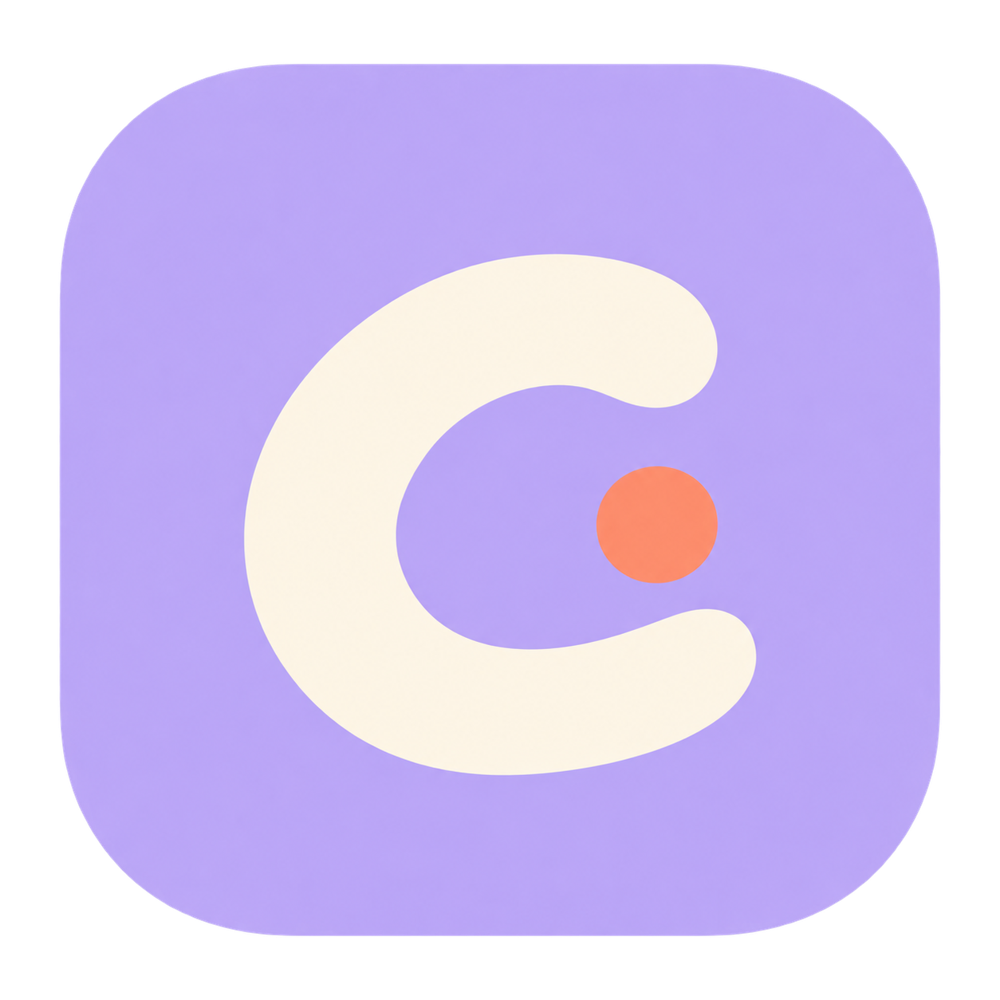
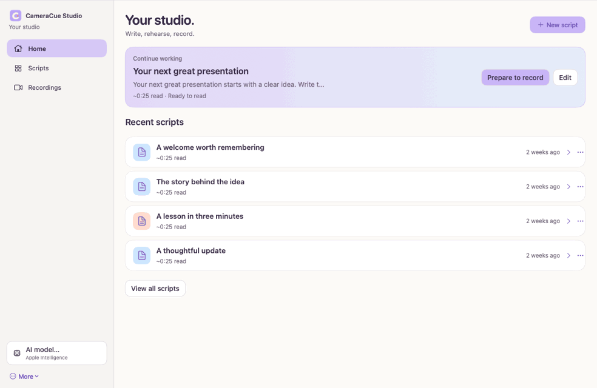

<p align="center">
  
</p>

<h1 align="center">CameraCue Studio</h1>
<p align="center"><strong>Your words, closer to the camera.</strong></p>
<p align="center">A native Mac studio for writing, rehearsing, and recording presentations.</p>

[](https://github.com/JoshuaColePhD/CameraCue/actions/workflows/macos-ci.yml)
[](LICENSE)

**Active development · Source and local builds available · No notarized installer yet**

<p align="center"></p>

*A short tour of production app views using sample scripts and simulated speech input. Camera and microphone stay off. [Studio screenshot](docs/media/studio.png) · [Reader screenshot](docs/media/reader.png) · [Focused Voice Follow GIF](docs/media/voice-follow.gif).*

---

CameraCue Studio brings your script, teleprompter, timer, and camera into one workspace. Its compact notch reader sits near the camera, follows your spoken words, and helps you keep track of time—so you can focus on delivering the message.

Built for educators, creators, professionals, and anyone who wants a more comfortable way to speak on camera.

**Native macOS · Voice Follow · On-device AI where available · Local video storage**

## From an idea to a finished take

1. **Write.** Start a script, import text, or develop an idea with AI. Add emphasis, pauses, and delivery cues without changing your spoken wording during formatting.
2. **Rehearse.** Adjust the reader, choose a time target, and practice. Voice Follow tracks your speech; manual controls remain available.
3. **Record.** Check your camera and microphone, then record. Keep the script near the lens and use pacing hints to watch your timing.
4. **Review.** Play back the saved MP4, find it in Finder, or try a different background and export a new version.

Preparing a take opens the setup screen; it does not start recording. Pausing the prompter leaves video recording running, and Stop finishes and saves the take.

Made a mistake? **↻ Restart take** saves the interrupted take and begins a new recording from the top, using your count-in setting. Saving errors retain a recoverable original instead of starting another recording. After a successful save, the notch confirms **Video saved** and collapses; Studio keeps the playback and actual save location visible.

## What you can do

| Feature | What it gives you |
| --- | --- |
| **Voice-following teleprompter** | Reading position and word highlighting respond to speech. Silence holds your place, and uncertain matches trigger recovery feedback. |
| **Camera-centered notch reader** | A compact, expandable overlay with adjustable height, native transitions, and support for MacBook and external displays. |
| **AI script development** | Draft from an idea, improve a draft, or suggest delivery cues. Suggestions remain reviewable. |
| **Performance formatting** | Use color, emphasis, pauses, and delivery cues to make scripts easier to perform. Formatting validates that spoken words are preserved. |
| **Presentation timing** | Count up or down, continue into overtime, and get pacing hints. Optional count-in helps you start a take. |
| **Built-in camera recording** | Record video and microphone audio to MP4, check framing, hide self-view, and review saved takes. |
| **Background effects** | Choose blur, pastel colors, built-in studio/landscape images, or an uploaded image. |
| **Background edits after recording** | Preview an effect and export a new MP4 without replacing the existing video. Keep a camera original to restore the real background later. |
| **Script and recording libraries** | Find scripts with search, filters, and favorites; open saved recordings for review. |

Prefer QuickTime? Turn off CameraCue's camera recording and use it as a separate teleprompter. CameraCue does not start or stop QuickTime.

## Designed for the person presenting

- **A quiet reader, a friendly studio.** Warm white surfaces, plum text, and pastel accents keep preparation approachable while the notch stays restrained.
- **Clear controls during a take.** Recording, prompting, and timing have distinct states. The camera can keep rolling while you pause to recover your place.
- **Your wording stays yours.** Formatting changes are checked against the spoken script; AI drafting and revision remain separate, reviewable actions.
- **Existing recordings stay intact.** Background changes create new files. Optional original copies give you more flexibility later.
- **Native editing and accessibility.** Standard text selection, undo/redo, keyboard navigation, descriptive controls, and Reduce Motion support.

## AI compatibility

**No API key or hosted LLM service is required.** CameraCue's current AI features use Apple's on-device language model through Foundation Models. The model is managed and downloaded by macOS; it is not bundled in this repository or the app. CameraCue does not route requests through a developer-funded AI account. External LLM providers and bring-your-own API keys are not currently supported.

Not every Mac supports Apple's on-device language model. CameraCue's **AI drafting, revision, delivery-cue generation, and AI-enhanced formatting** require:

- An Apple Intelligence-compatible Mac, including **M1 and newer Apple silicon Macs**. **Intel Macs do not support Apple Intelligence.**
- **macOS 26 or later** for the Foundation Models framework.
- **Apple Intelligence enabled**, with its on-device model downloaded and ready.
- A supported language and region; availability can vary.

See [Apple's hardware and availability requirements](https://support.apple.com/en-us/121115) and [Foundation Models availability](https://developer.apple.com/documentation/FoundationModels/generating-content-and-performing-tasks-with-foundation-models).

The **editor, camera recording, manual prompting, and basic local formatting do not require this language model**. When it is unavailable, formatting uses a clearly labeled, word-preserving local fallback; AI drafting and revision are unavailable. Voice Follow uses the separate speech recognition system and has its own permission and availability checks.

## Your files stay local

CameraCue has no required cloud account or cloud video storage. Scripts and recordings are stored on your Mac; this repository does not include personal scripts, recordings, or settings.

| Data | Default location |
| --- | --- |
| Script library | `~/Library/Application Support/CameraCue/scripts.json` |
| Saved MP4 recordings | `~/Movies/CameraCue/` |
| Optional camera originals | `.Originals/` inside the recording folder |
| Background-edited videos | New MP4s beside the existing recording |
| Uploaded background images | `~/Library/Application Support/CameraCue/Backgrounds/` |

Change the recording folder in **Camera & recording**. Keep a video's optional `.cameracue.json` sidecar and original folder together when moving files if you want to retain the original-source link.

Background processing uses Vision and Core Image locally. AI drafting and formatting use Apple's on-device language model when available; formatting has a clearly labeled local fallback. Voice Follow uses Apple's speech recognition services and requests on-device recognition when supported. Camera and microphone access are requested when you preview or record.

## Engineering behind the experience

CameraCue combines product design with native platform integration, asynchronous media processing, and defensive state management.

| Area | Implementation |
| --- | --- |
| **App interface** | SwiftUI with AppKit for native editing, windows, controls, and video playback. |
| **Reader motion** | Core Animation shell and mask transitions, reversible from visible positions, without publishing animation frames through SwiftUI. |
| **Speech tracking** | Speech framework and AVAudioEngine, with token alignment, word highlighting, recovery states, and pacing logic. |
| **On-device AI** | Foundation Models for script development and validated formatting suggestions, with availability checks and formatting fallback. |
| **Video pipeline** | AVFoundation video/audio data outputs, H.264/AAC writers, and MP4 export. Session work and frame processing run off the UI thread. |
| **Background processing** | Vision person segmentation and Core Image compositing. Preview and recording share processed frames; offline edits use accurate segmentation. |
| **Data integrity** | Versioned optional recording sidecars, source-preserving exports, cancellation cleanup, and recoverable MOV files after export failures. |
| **Testability** | A separate core module, injectable capture fixtures, generated video/audio tests, and regression coverage for lifecycle and navigation behavior. |

### Engineering decisions worth exploring

- **Separate reusable logic from platform UI:** `TeleprompterCore` contains alignment, timing, token anchors, formatting, and tracking/pacing logic; `TeleprompterApp` owns macOS integration.
- **Bound the work that reaches the UI:** preview delivery coalesces pending frames instead of rebuilding SwiftUI for every camera frame.
- **Treat cancellation as part of the workflow:** capture startup and finalization have explicit guards; cancelled file exports clean up their own partial outputs.
- **Preserve user data across edits:** source recordings remain unchanged, older script metadata remains readable, and missing original-video links fall back to the available recording.

See [ARCHITECTURE.md](ARCHITECTURE.md) for design decisions and AI-assisted development, [Voice Follow evaluation](docs/VOICE_FOLLOW_EVALUATION.md) for measured results, and [DEVELOPMENT.md](DEVELOPMENT.md) for build details and [Assets/Backgrounds.md](Assets/Backgrounds.md) for bundled image provenance.

### Voice Follow evidence

On the held-out transcript replay, the revised tracker stayed within two tokens on **99.44%** of callbacks, versus **92.63%** for the previous tracker and **89.25%** for an exact-match baseline. It recovered from all 12 scripted skips/restarts with no erroneous jumps. These are synthetic recognizer-error tests on published transcripts, **not measured live ASR performance**. [Read the methodology, results table, and remaining limitations](docs/VOICE_FOLLOW_EVALUATION.md).

### Machine-learning work in progress

An [AMI real-audio pilot](docs/evaluation/ami-pilot/README.md) compares standard and fast on-device SpeechAnalyzer reporting at 1x playback, with speaker-separated data and explicit timing provenance. Local pace calibration and timestamped recording feedback are implemented in the development build. An optional confidence model is scoped to short scripts and remains off by default; the legacy-engine comparison and broader hardware acceptance remain incomplete. The pilot does not establish general production accuracy.

The AMI evaluation data and experimental weights carry CC BY 4.0 attribution. CameraCue source code remains MIT. Raw corpus audio and user recordings are excluded from the repository and application bundle.

## Try a local build

**Status:** a working native app under active development. This repository provides source and local build instructions; it does not currently offer a notarized customer installer.

### Requirements

- macOS 15 or later.
- Xcode with the macOS 26 SDK or later, Swift 6.2 or later, and command-line tools selected.
- Python 3 for icon packaging; the packaging script uses its standard library and macOS `sips`.
- For generative AI features, the additional [AI compatibility requirements](#ai-compatibility) above apply. Core editing, recording, and manual prompting do not require Apple's language model.

### Build and install

```sh
git clone https://github.com/JoshuaColePhD/CameraCue.git
cd CameraCue
./build-app.sh release
```

The build produces `dist/CameraCue Studio.app` with an ad hoc signature for local use.

Quit an idle CameraCue Studio instance before installing:

```sh
ditto "dist/CameraCue Studio.app" "/Applications/CameraCue Studio.app"
codesign --verify --deep --strict "/Applications/CameraCue Studio.app"
```

Distribution to other Macs requires Developer ID signing and notarization.

### Verification

```sh
swift test --disable-sandbox
./scripts/evaluate-voice-follow.sh --check --output /tmp/voice-follow-results.json
```

The [Mac CI workflow](https://github.com/JoshuaColePhD/CameraCue/actions/workflows/macos-ci.yml) reports test totals and uploads verification evidence on every run. Coverage includes alignment, timers, word preservation, library persistence, capture lifecycle, background exports, rotation, cancellation, native controls, and editor selection.

Graphics and encoding tests need access to macOS services. Private recorded-clip checks skip when their local fixture is unavailable; the repository intentionally excludes those videos. Automated tests do not start a live camera or microphone.

Short recordings have been saved on the development Mac. Live speech accuracy/latency, lengthy takes, audio synchronization by listening, and varied monitor arrangements remain [hardware acceptance checks](docs/ACCEPTANCE.md). Background segmentation can soften fine edges, and offline processing may take longer than the clip's running time.

---

Created by [Joshua Cole](https://github.com/JoshuaColePhD). Licensed under [MIT](LICENSE).
